  

    

  
  
  

 

## About Me

I'm **Monu Kumar**, a Computer Science Engineering graduate (AI &amp; ML specialization, Chandigarh University) focused on building **Agentic AI workflows**, **cloud-native infrastructure**, and **high-throughput Python backend systems**.

From designing multi-agent LLM orchestration and automated evaluation pipelines (`ComputerBench` / `Terminal-Bench 2.0`) to shipping horizontally scalable REST APIs on **AWS**, **Docker**, and **Kubernetes**, I care about turning complex AI &amp; backend ideas into **fast, deterministic, production-ready software**.

---

## Core Engineering Pillars

<table>
  <tr>
    <td width="33%" valign="top">
      <h3>🤖 Agentic AI &amp; LLM Systems</h3>
      <ul>
        <li><strong>Multi-Agent Orchestration:</strong> Role-based agents, Dual-Model + CriticAgent pipelines, and Chain-of-Thought workflows.</li>
        <li><strong>RAG &amp; Vector Search:</strong> Context-aware retrieval with <strong>ChromaDB</strong> and structured knowledge indexing.</li>
        <li><strong>Agent Evals &amp; Tooling:</strong> SaaS REST integrations (Slack, Linear, Jira, Notion, Gmail) and Dockerized benchmark suites.</li>
      </ul>
    </td>
    <td width="33%" valign="top">
      <h3>☁️ Cloud &amp; DevOps</h3>
      <ul>
        <li><strong>Cloud Infrastructure:</strong> Deploying scalable services across <strong>AWS</strong> and <strong>Google Cloud</strong>.</li>
        <li><strong>Containers &amp; Orchestration:</strong> Production <strong>Docker</strong> workflows and <strong>Kubernetes</strong> horizontal scaling.</li>
        <li><strong>CI/CD &amp; Automation:</strong> Git-driven pipelines, Linux tooling, and reproducible test environments.</li>
      </ul>
    </td>
    <td width="33%" valign="top">
      <h3>⚙️ Backend Architecture</h3>
      <ul>
        <li><strong>High-Throughput APIs:</strong> <strong>Python / FastAPI</strong> services engineered for <strong>500+ req/s</strong> under load.</li>
        <li><strong>Latency &amp; Caching:</strong> <strong>Redis</strong> caching layers driving <strong>30 ms</strong> avg response times and <strong>+60%</strong> throughput.</li>
        <li><strong>Data &amp; Auth:</strong> <strong>PostgreSQL</strong>, <strong>MySQL</strong> query tuning (<strong>40%</strong> faster queries), <strong>Elasticsearch</strong>, and <strong>JWT</strong> RBAC.</li>
      </ul>
    </td>
  </tr>
</table>

---

## Experience &amp; Featured Systems

<table>
  <tr>
    <td width="50%" valign="top">
      <h3>💼 Experience</h3>
      

        <strong>Turing (Client: Perplexity AI)</strong> 
        <em>AI Training Contractor — Software Engineer (Python &amp; Docker)</em> · <code>Aug 2026 – Sep 2026</code>
      

      <ul>
        <li>Built Python REST API integrations simulating Slack, Linear, Jira, Notion, Gmail, and internal wikis.</li>
        <li>Authored agentic/coding eval tasks on <strong>ComputerBench</strong> &amp; <strong>Terminal-Bench 2.0</strong> with 30+ automated Docker test cases per task.</li>
      </ul>
      

        <strong>Eroadmap Digital Solutions</strong> 
        <em>Backend Developer Intern</em> · <code>May 2025 – Oct 2025</code>
      

      <ul>
        <li>Deployed a horizontally scalable API server on <strong>AWS</strong> handling <strong>500+ req/s</strong>.</li>
        <li>Cut MySQL query response times by <strong>40%</strong> and reached <strong>30 ms</strong> avg latency (<strong>+60%</strong> throughput) with <strong>Redis</strong>.</li>
      </ul>
    </td>
    <td width="50%" valign="top">
      <h3>🚀 Featured Builds</h3>
      

        <strong>NeuroLearn — Multi-Agent Adaptive Learning</strong> · <code>2026</code> 
        <code>Python</code> · <code>FastAPI</code> · <code>Multi-Agent LLMs</code> · <code>RAG</code> · <code>ChromaDB</code> · <code>Docker</code>
      

      <ul>
        <li>Multi-service backend with specialized agents (<code>ProctorAgent</code>, <code>PsychometricianAgent</code>, <code>PathArchitectAgent</code>, <code>ContentCuratorAgent</code>).</li>
        <li>Dual-Model + <code>CriticAgent</code> quality judge, Item Response Theory (IRT), Bloom's Taxonomy, and RAG validated by a 51-test E2E suite.</li>
      </ul>
      

        <strong>Ecommerce API Server</strong> · <code>2025</code> 
        <code>Python</code> · <code>FastAPI</code> · <code>AWS</code> · <code>Docker</code> · <code>Kubernetes</code> · <code>MySQL</code> · <code>Redis</code> · <code>JWT</code>
      

      <ul>
        <li>High-availability REST API sustaining <strong>500+ req/s</strong> with horizontal scaling, JWT RBAC, MySQL persistence, and Redis caching.</li>
      </ul>
    </td>
  </tr>
</table>

---

## Tech Stack

<table>
  <tr>
    <td width="24%"><strong>Languages &amp; Core</strong></td>
    <td>
      
      
      
      
    </td>
  </tr>
  <tr>
    <td><strong>Cloud &amp; DevOps</strong></td>
    <td>
      
      
      
      
      
      
      
    </td>
  </tr>
  <tr>
    <td><strong>Backend &amp; Databases</strong></td>
    <td>
      
      
      
      
      
      
    </td>
  </tr>
  <tr>
    <td><strong>Agentic AI &amp; ML</strong></td>
    <td>
      
      
      
      
      
      
    </td>
  </tr>
</table>

---

## Certifications &amp; Education

- **Oracle Cloud Infrastructure 2024 Generative AI Certified Professional** — *Oracle*
- **Python for Data Science, AI &amp; Development** — *IBM (Coursera)*
- **Introduction to Big Data** — *UC San Diego (Coursera)*
- **Machine Learning for All** — *University of London (Coursera)*
- **B.E. in Computer Science Engineering (Specialization in AI &amp; ML — IBM)** — *Chandigarh University (2022 – 2026)*

---

## Connect

- **Email:** [monumahto.educational@gmail.com](mailto:monumahto.educational@gmail.com)
- **LinkedIn:** [linkedin.com/in/developer-monu](https://linkedin.com/in/developer-monu)
- **GitHub:** [github.com/developermonu](https://github.com/developermonu)
